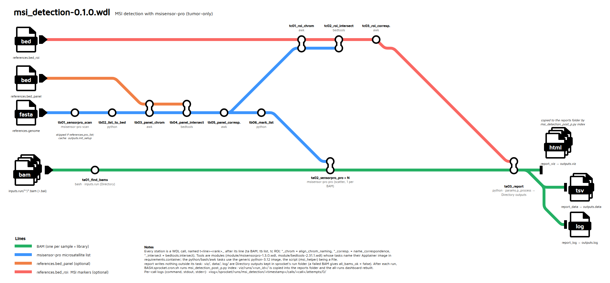

# msi_detection-0.1.0.wdl

Everything about the WDL workflow lives in this folder (`pipeline-jp/wdl/`).


WDL port of [`run_msisensor2.0.1.py`](../python-pipeline/run_msisensor2.0.1.py) (see [its README](../python-pipeline/README.md)), run with
[sprocket](https://sprocket.bio). It runs MSIsensor-pro (tumor-only) on every BAM of a run directory,
restricts the analysis to a sequencing panel and/or the classic MSI markers (BAT26, NR21, ...), and
updates the same HTML reports as the Python pipeline (all runs → one run → one sample).



(Editable diagram: [`diagram/msi_detection_metromap.drawio`](diagram/msi_detection_metromap.drawio); re-export the PNG with `diagram/BASH.render_png.sh`.)

## Contents

- [Quick start](#quick-start)
- [Tasks](#tasks)
- [Inputs](#inputs)
- [Outputs](#outputs)
- [Containers: development vs production](#containers-development-vs-production)
- [Files](#files)
- [HTML documentation](#html-documentation)

## Quick start

```sh
cd /media/jp/SSD2/CHU/code/pipeline-jp/wdl
./BASH.sprocket.sh                    # cron mode: pre_process picks the run left to analyse, then runs it
./BASH.sprocket.batch.sh CONFIG_DIR   # batch mode: every params JSON of CONFIG_DIR
```

`BASH.sprocket.sh` (cron) first runs `msi_detection_pre_p.py`, which writes the params JSON of
the run finished by ADIVAR and not yet in the MSI locker (moved to `$WORK/config/`) and adds that run
to the locker. Then both scripts, for each params JSON:

1. sets the destinations, hardcoded in the script (not in the params): `VIZ` (reports folder) and
   `WORK` (sprocket's runs), created if needed;
2. runs `sprocket run -s -c $SPROCKET_CONFIG` (default `backends.conf/sprocket.local.toml`) in
   `$WORK/sprocket/runs/msi_detection/<timestamp>/`, one folder per task;
3. runs `msi_detection_post_p.py index` as a Slurm job (`srun`, in `python-3.12.sif`): copies the run's
   `viz/runs/<run_id>/` into `$VIZ/runs/` and rebuilds the dashboard from every
   `$VIZ/runs/*/` (`index_msi_run.js`, `index_msi_sample.js`; the two `.html` are written once,
   only rewritten if their template changes).

The workflow itself never writes outside its tasks: the dashboard covers every run, a state that
changes with each run, so it is built after the run (`index`), not by a task (a task reading the
current reports would not be reproducible nor cacheable). `index` can be re-run at any time, e.g.
after deleting a run folder. Everything else stays in sprocket's run folder (paths in its
`outputs.json`), every task keeping its `work/` folder (~300 MB per run).

Run by hand:

```sh
sprocket run -s -c backends.conf/sprocket.local.toml msi_detection-0.1.0.wdl @params/example_params_1.json
```

## Tasks

In execution order. Tools are wrapped in **modules**, imported by the workflow:

```wdl
import "module/msisensorpro-1.3.0.wdl" as msisensorpro   # tasks scan, pro
import "module/bedtools-2.31.1.wdl" as bedtools           # task intersect
```

Module tasks are generic (the tool's own options only), declare their image in
`requirements.container` and can be reused by other workflows; the pipeline-specific steps are
tasks of `msi_detection-0.1.0.wdl`, in a generic python3 + awk image (`helper_container`,
`apptainer-recipes/python-3.12.sif`); the python script is given to them as a `File`, not built into the image.

Calls are named after their line on the diagram, `t<line><rank>_<step>`: `ta` BAMs (green),
`tb` msisensor-pro list (blue, panel steps included), `tc` ROI markers (red). A WDL name can't
start with a digit, hence the letter; sprocket's `calls/<call>/` folders group the same way.

| Call (task) | Runs | What it does | Main output |
|---|---|---|---|
| `ta01_find_bams` (`find_bams`) | python image, bash | Lists every `*.bam` of the run directory (`inputs.run`) (sub-folders with `params.recursive`), with its index (`.bam.bai` or `.bai`), its library (folder relative to `input_dir`, `.` if none) and its sample name (BAM basename). `inputs.run` is a `Directory` (mounted by the engine); paths are returned relative to it. With `inputs.samples`, keeps only the BAMs whose name contains one of these IDs (every library). Fails if a BAM has no index, no BAM is found, or a sample ID matches no BAM. | `bams`: one row per BAM |
| `tb01_sensorpro_scan` (`msisensorpro.scan`) | msisensor-pro | `msisensor-pro scan` of the genome: every microsatellite site. Skipped when `references.pro_list` is given. Not redone from one run to the next: sprocket's call cache (`[run.task] cache = "on"`) reuses the previous scan (same genome, image and `threads`), as long as that run's folder is kept. | `<genome>.msisensor_pro.list` |
| `tb02_list_to_bed` (`list_to_bed`) | python image | Converts the list to BED6 (start = location − 1, end = start + unit length × repeat times). | `<list>.bed` |
| `tb03_panel_chrom` (`align_chrom_naming`) | python image, awk | Only with `bed_panel`. Copy of the panel BED with its chromosome names (`chr1` / `1`) aligned on the list's: bedtools matches them literally. | `<panel>.chrnorm.bed` |
| `tb04_panel_intersect` (`bedtools.intersect`) | bedtools | `bedtools intersect -wa -wb -f 1.0`: the sites fully inside a panel region, one row per overlap. | `<list>.panel.intersect.tsv` |
| `tb05_panel_correspondence` (`name_correspondence`) | python image, awk | Turns the intersection into a BED6 named `<site>#<probe>#<chrom:start-end>`. | `<list>.panel.bed` |
| `tb06_mark_list` (`mark_list`) | python image | Only with `bed_panel`. Full list, same rows, `filter` = `PASS` for the panel sites, `NO` elsewhere: **the list analysed by msisensor-pro**. | `<list>.panel.list` |
| `tc01_roi_chrom`, `tc02_roi_intersect`, `tc03_roi_correspondence` | python image / bedtools / python image | Only with `bed_roi`. Same three steps with the ROI markers, on the panel sites when there is a panel (genome-wide otherwise). Name ends with `#<marker>`. | `<list>.panel.roi.bed` |
| `ta02_sensorpro_pro` × N (`msisensorpro.pro`) | msisensor-pro | Scatter, one per BAM: `msisensor-pro pro -d <analysis list> -t <bam> -b threads -c coverage_threshold`. A failure on any BAM fails the workflow. | `<sample>`, `_all`, `_dis`, `_unstable` |
| `ta03_report` (`report`) | python image | Gets every BAM's results as `File`s, copies them to `data/<run_id>/<library>/`, builds this run's reports in `viz/runs/<run_id>/` (run page, sample pages; the all-runs dashboard is built by `index` after the run) and writes the log; writes nothing outside its task. | `viz/`, `data/`, `log/` (`Directory`) |

The python steps are subcommands of two scripts:
[`scripts/msi_detection_main_p.py`](scripts/msi_detection_main_p.py) (`list-to-bed`, `mark-list`: the
reference list) and [`scripts/msi_detection_post_p.py`](scripts/msi_detection_post_p.py) (`report`, and
`index` after the run); the report code is the one of `run_msisensor2.0.1.py`.

## Inputs

Keys of the params JSON, all prefixed `msi_detection.` (see [`params/example_params_1.json`](params/example_params_1.json)).
`inputs`, `references` and `params` are objects (WDL structs); where results go is not a
params key (see `BASH.sprocket.sh`):

```json
"msi_detection.inputs":     {"run": "...", "samples": ["E25D04852T", "..."]},
"msi_detection.references": {"genome": "...", "bed_panel": "...", "bed_roi": "...", "pro_list": "..."},
"msi_detection.params":     {"threads": 8, "coverage_threshold": 1, "recursive": true, "p_process": {"min_reads": 200, "pval_cutoff": 0.1, "sample_na_fraction": 0.5}},
```

Optional members can be left out of their object.

| Object / input | Member | Required | Description |
|---|---|---|---|
| `inputs` (`InputDirs`) | `run` | yes | Run directory; its name is the `run_id` |
| | `samples` | no | Sample IDs: only the BAMs whose name contains one of them are analysed (an ID with no BAM fails the run). Without it: every BAM but the controls |
| `references` (`References`) | `genome` | yes | Fasta the BAMs are aligned on |
| | `pro_list` | no | Existing scan list: skips the scan |
| | `bed_panel` | no | Plain panel BED (no `track` line, e.g. `*.amplicons.bed`) |
| | `bed_roi` | no | MSI markers BED (e.g. `ROI.hg19.bed`) |
| `params` (`RunParams`) | `threads` | yes | `pro -b` |
| | `coverage_threshold` | yes | `pro -c` |
| | `recursive` | yes | Also look for BAMs in sub-folders (one per library) |
| | `p_process.min_reads` | yes | Reports: a site counts (% unstable, site status) only with ≥ this many reads (e.g. 200) |
| | `p_process.pval_cutoff` | yes | Reports: a site is unstable when its p-value is above this (e.g. 0.1) |
| | `p_process.sample_na_fraction` | yes | Reports: sample status NA when more than this fraction of its loci are NA or MSU (e.g. 0.5) |
| `msisensorpro_container`, `bedtools_container` | | no (set in the WDL: `apptainer-recipes/*.sif`) | Image of each tool (see below) |
| `helper_container` | | no (set in the WDL: `apptainer-recipes/python-3.12.sif`) | Generic python3 + awk image of the python/bash tasks |
| `msi_main_helper` | | no (set in the WDL: `scripts/msi_detection_main_p.py`) | Python reference list steps, a `File` |
| `msi_post_helper` | | no (set in the WDL: `scripts/msi_detection_post_p.py`) | Python report steps, a `File` |

The genome, panel and ROI must use the same build as the BAMs (e.g. GRCh37 + `ROI.hg19.bed`).

## Outputs

Returned by `ta03_report` as `Directory` outputs, in its `work/` folder of the run directory;
`index` then adds `runs/<run_id>/` to `$VIZ` and builds the dashboard there:

```
<VIZ>/index_msi_run.html                       all runs (written once, reads index_msi_run.js)
<VIZ>/index_msi_sample.html                    all samples of all runs (written once, reads index_msi_sample.js)
<VIZ>/runs/<run_id>/<run_id>_index_run.html     one row per sample, one column group per library
<VIZ>/runs/<run_id>/<sample>_index_sample.html  one sample, pooled across its libraries
data/<run_id>/<library>/<sample>{,_all,_dis,_unstable}
log/<run_id>_MSI_<timestamp>.log
```

sprocket's own run directory (with `BASH.sprocket.sh`: `$WORK/sprocket/runs/msi_detection/<timestamp>/`, `_latest` → last run):

```
output.log        sprocket's log
inputs.json       resolved inputs
outputs.json      workflow outputs (also printed by sprocket run)
calls/<call>/attempts/0/{command,stdout,stderr,work/}   each call (ta01_find_bams, ...)
```

Workflow outputs (`outputs.json`): `msi_reference_list`, `msi_analysis_list`,
`panel_correspondence_bed`, `roi_correspondence_bed`, `msisensorpro_all`,
`msisensorpro_unstable`, `report_viz`, `report_data`, `report_log`
(Directory).

## Containers: development vs production

Tool tasks only name their image and call the tool directly:

```wdl
command <<<
    msisensor-pro pro -d "~{msi_list}" -t "~{bam}" -o "~{sample_name}" ...
>>>
requirements {
    container: container
}
```

Development and production use the same backend, `slurm_apptainer`: sprocket submits every task
with `sbatch` and runs it with `apptainer exec` in its image, mounting its `File`/`Directory`
inputs and its work directory (nothing else of the host is visible).

| | Development | Production |
|---|---|---|
| Config | `backends.conf/sprocket.local.toml` | `backends.conf/sprocket.prod.toml` |
| Slurm | single node on this workstation (`backends.conf/slurm-local/install.sh`) | the cluster, partition `prod`, 600 min |
| `*_container` | WDL default: `file://.../apptainer-recipes/<tool>.sif` | override in the prod JSON: `file:///bioinfo/apptainer_sif/<tool>_<version>.sif` |

The python scripts are deliberately **not** in the image: they are `File` inputs (`msi_main_helper`, `msi_post_helper`),
versioned with the WDL, so editing it needs no image rebuild (a frozen image with the script inside
only if the workflow is ever distributed without this folder).

Every task only reads its inputs and writes in its own directory (the run directory is a
`Directory` input, the reports are `Directory` outputs). The reports folder (`$VIZ`) is only
written by `index`, after the run.

## Files

| File | Role |
|---|---|
| `msi_detection-0.1.0.wdl` | The workflow |
| `module/msisensorpro-1.3.0.wdl`, `module/bedtools-2.31.1.wdl` | Tool modules (tasks `scan`, `pro`; `intersect`) |
| `scripts/msi_detection_pre_p.py` | Before the workflow: params JSON of the runs left to analyse (run by `BASH.sprocket.sh`) |
| `scripts/msi_detection_main_p.py` | Reference list steps (`msi_main_helper`) |
| `scripts/msi_detection_post_p.py` | Report and dashboard steps (`msi_post_helper`, and `index` after the run; page icon embedded) |
| `apptainer-recipes/python-3.12.def` | Generic python3 + awk image of the python/bash tasks |
| `params/example_params_1.json` | Params for Run141_Juno (GRCh37, Juno v3 panel, ROI hg19) |
| `backends.conf/sprocket.local.toml`, `sprocket.prod.toml` | sprocket configs: Slurm + Apptainer, this workstation / the cluster |
| `backends.conf/slurm-local/` | Single-node Slurm of this workstation (`sudo ./install.sh`) |
| `BASH.sprocket.sh`, `BASH.sprocket.batch.sh` | `sprocket run` with this folder's config: cron mode (run found by pre_process) / batch mode (folder of params JSON) |
| `BASH.doc.sh`, `apptainer-recipes/sprocket-doc-0.31.0.def` | HTML documentation (`docs/`, generated) and its image |
| `diagram/msi_detection_metromap.drawio` / `.preview.png`, `diagram/BASH.render_png.sh` | Workflow diagram, its PNG export |

## HTML documentation

Generated by sprocket from the WDL's `meta` / `parameter_meta`, with this README as home page:

```sh
./BASH.doc.sh        # sprocket dev doc . --output docs --index-page README.md ... + diagram copy
```

Open `docs/index.html`. The search bar needs the pages to be served over http (browsers block its
index files from `file://`):

```sh
python3 -m http.server -d docs 8000      # then http://localhost:8000
```

`BASH.doc.sh` runs `sprocket dev doc` in `apptainer-recipes/sprocket-doc-0.31.0.sif` (sprocket +
Node.js + `pagefind`, pre-cached for the search index): nothing to install on the host, no download.
Rebuild the image with:

```sh
cd apptainer-recipes && apptainer build --fakeroot sprocket-doc-0.31.0.sif sprocket-doc-0.31.0.def
```


